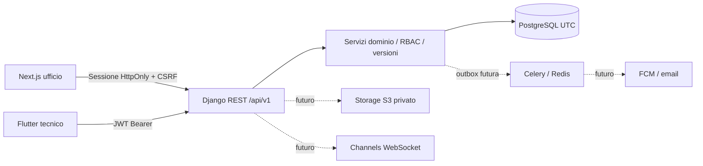

# Architettura

Monorepo nella radice attuale (nessuna cartella contenitore aggiuntiva).
`backend/`: Django, DRF, PostgreSQL; `infrastructure/`: Docker Compose;
`docs/`, `scripts/`, `tests/`: contratti, strumenti e verifiche.
`apps/web/` contiene il client Next.js della fase 3; `apps/mobile/` è la
destinazione della fase 4.
Il Flutter preesistente resta in `progetti/idraulica_app` fino alla migrazione verificata.

Moduli iniziali: accounts per utenti/sessioni; operations per dominio e API.
Le mutazioni intervento sono transazionali: lock su tecnici in ordine stabile, poi
intervento; versione obbligatoria; validazione sovrapposizioni; audit/storico nella
stessa transazione. PostgreSQL è il database di riferimento. SQLite è esclusivamente
un'opzione esplicita per test rapidi: non verifica lock/concorrenza PostgreSQL.
Entità avanzate presenti come schema, senza endpoint prematuri.

Redis condiviso per throttle in produzione, broker Celery e channel layer.
Channels/Celery hanno configurazione iniziale; consumer chat e task push saranno
implementati nella fase 5 con outbox, deduplica e autorizzazioni.
Storage e integrazioni esterne non attivate nella fase 2.

Per il web si userà session authentication Django, cookie HttpOnly Secure e CSRF
con endpoint bootstrap. Per mobile JWT di 5 minuti e refresh 1 giorno ruotato con
blacklist; revoca sessione verificata a ogni richiesta, inclusi access token.
Nessuna business rule critica nel client.

Scelte basate sulla documentazione ufficiale:
[locking Django](https://docs.djangoproject.com/en/dev/ref/models/querysets/),
[rotazione Simple JWT](https://django-rest-framework-simplejwt.readthedocs.io/en/latest/settings.html).
Versioni effettivamente installate fissate in `backend/requirements.txt`.
Deploy, scaling, S3 e proxy HTTPS saranno verificati nelle fasi successive.

Fase 3: il browser chiama solo `/api/v1/` sul dominio Next; le rewrites server
inoltrano a `BACKEND_URL` preservando cookie, CSRF e slash finale Django.
Nessun token nel client, nessun segreto `NEXT_PUBLIC_*`. L'origin browser viene
verificata da Django contro la allowlist. In produzione una reverse proxy HTTPS
può instradare direttamente `/api/v1/` a Django mantenendo lo stesso contratto.
Il runtime React usa Query per cache in memoria e invalidazione dopo le mutazioni;
calendario/overview aggiornati ogni 30 secondi. Liste operative paginate, calendario
limitato alla finestra visibile; selezione clienti con ricerca server da 25 risultati.
Il backend pubblica transizioni consentite e capacità di ripianificazione per
ridurre duplicazioni di policy; ogni azione resta validata dal servizio di dominio.
