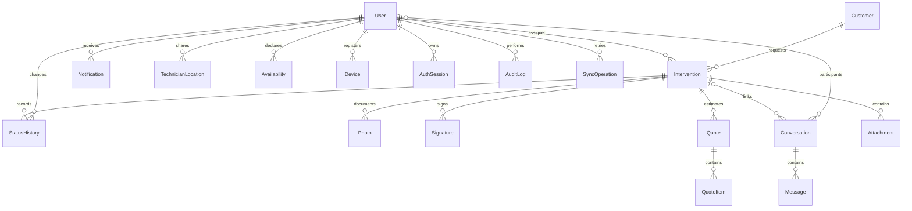

# Database

PostgreSQL, timestamp UTC (`USE_TZ`), UUID per risorse operative, email univoca
anche case-insensitive. Password gestita esclusivamente da Django.
FK protette per clienti/tecnici/interventi e audit conservato; nessuna cancellazione
a cascata dei lavori attraverso una cancellazione anagrafica.

Intervention: FK cliente/tecnico, titolo, descrizione, tipo, priorità, inizio/fine,
indirizzo, stato, note ufficio/tecnico, versione, created/updated. Vincolo fine > inizio,
indice tecnico/inizio e stato/inizio. Assegnazione a tecnico attivo validata dal servizio.
StatusHistory: precedente/nuovo, attore, timestamp; append-only attraverso API.
Customer: nome, cognome/ragione sociale, telefono/email, indirizzo/città/CAP,
coordinate accoppiate con range, note. Indice nome/città.

Photo/Attachment: chiave storage privata, uploader, data, tipo; nessun URL pubblico.
Signature: chiave, snapshot, hash documento e data; servizio immutabile da fase 4.
Quote/QuoteItem: stato e note, righe con quantità, prezzo unitario e IVA decimali;
vincoli importi non negativi. Calcolo/PDF nella fase 5.
Conversation/Message: partecipanti, intervento opzionale, mittente, testo e timestamp;
lettura per partecipante da estendere nella fase 5.
Notification: destinatario, tipo, testo generico, read_at e deduplication_key univoca.
TechnicianLocation: lat/lon validati, timestamp, autorizzazione lavorativa; retention
e ingestione disabilitate fino alla scelta privacy.
Availability: tecnico, intervallo e disponibilità; fine > inizio.
Device: proprietario, token univoco, piattaforma, attivo.
SyncOperation: utente + operation_id univoci, digest richiesta e risposta per replay;
eseguita atomicamente con cambio stato. La risposta contiene solo id/stato/versione.
AuthSession: UUID nei JWT, utente, creato/scadenza/revoca; controllata su ogni uso.
AuditLog: attore, azione, entity_id, timestamp e soli metadati tecnici non sensibili.
CompanySettings: singleton, timezone, IVA predefinita, condivisione GPS off.

Migrazioni versionate in `backend/*/migrations/`. Test DB con PostgreSQL richiesti
per lock e collisioni concorrenti; i test SQLite non dimostrano tali proprietà.
